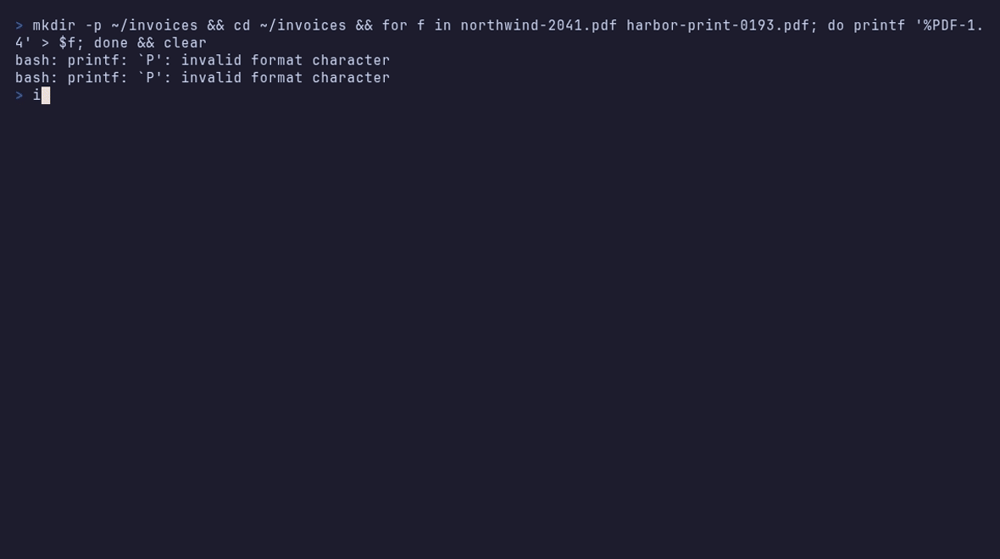

# Invoist CLI

Read invoices, work through the ones set aside for checking, and see what's
left to pay, from your terminal.



- **Commands for scripts.** `invoist extract invoices/ --json` uploads a
  folder and prints what Invoist read. Without a terminal, nothing prompts,
  draws or uses colour, and exit codes say what happened.
- **A full-screen app for people.** Run `invoist` on its own to browse
  invoices, check the ones set aside, upload files, or see a household's
  bills, with the keyboard or the mouse.

The CLI is built on the official Rust SDK,
[`invoist`](https://crates.io/crates/invoist), so retries, errors and
webhook checks behave as they do in every Invoist SDK. It sends nothing
anywhere except the Invoist API: no telemetry and no update checks.

## Install

On macOS or Linux:

```sh
curl -fsSL https://invoi.st/cli/install.sh | sh
```

On Windows, in PowerShell:

```powershell
powershell -ExecutionPolicy Bypass -c "irm https://invoi.st/cli/install.ps1 | iex"
```

The script downloads the newest
[release](https://github.com/invoisthq/cli/releases) for your
computer and puts `invoist` in `~/.cargo/bin`, adding that folder to your
`PATH` if it's missing. You don't need Rust. Both addresses lead to the
installer scripts attached to the latest release, so you can read them there
first.

With Homebrew:

```sh
brew install invoisthq/tap/invoist
```

Or build it with Rust 1.88 or newer:

```sh
cargo install invoist-cli --locked
```

Check it works:

```sh
invoist --version
# invoist 0.1.0 (Rust SDK 1.0.1)
```

## Sign in

```sh
invoist login
```

Your browser opens on Invoist. Approve the CLI there and you're signed in;
the terminal says which workspace it is. Nothing is copied or pasted, and the
CLI never sees your password. Over SSH, `invoist login --no-browser` prints
the link to open on any device.

The CLI can then do what you approved: a business workspace reaches
invoices, a household reaches bills. It shows only the commands that work for
your account.

For a script or CI, use an API key instead. Create one in Invoist: a business
under **Integrations, then API**; a household under **Settings, then AI
assistants**. Then either:

```sh
invoist login --with-key < key.txt     # saved, like a browser sign-in
export INVOIST_API_KEY=inv_sk_test_... # or only for this shell
```

A test key (`inv_sk_test_`) returns a fixed result and is never charged, so
it's a safe way to try every command.

`invoist status` shows who you're signed in as and whether it still works.
`invoist logout` signs out and forgets the saved sign-in.

### Where the sign-in is kept

In the system keychain: Keychain on macOS, Credential Manager on Windows and
the Secret Service (GNOME Keyring, KWallet) on Linux. Where there's no
keychain, such as a server without a desktop, it goes in the config file,
readable only by you. The config file holds each profile's settings:

| System | Config file |
|---|---|
| Linux | `~/.config/invoist/config.toml` |
| macOS | `~/Library/Application Support/st.Invoist.invoist/config.toml` |
| Windows | `%APPDATA%\Invoist\invoist\config\config.toml` |

There is no `--api-key` flag, because flags end up in shell history and
process lists. A browser sign-in renews itself; you sign in again only if
it hasn't been used for 90 days.

### More than one account

Profiles keep sign-ins apart, such as a test key and your live workspace:

```sh
invoist login --profile test --with-key < test-key.txt
invoist --profile test extract invoice.pdf
invoist profile list
invoist profile use test      # make it the default
```

## A business workspace

```sh
invoist extract invoice.pdf               # upload and wait for the result
invoist extract invoices/ --concurrency 8 # a whole folder, 8 at a time
invoist documents list --flagged          # set aside for a person to check
invoist documents get 4f9c2a1e            # one invoice, as a readable card
invoist documents download 4f9c2a1e --out invoice.pdf
invoist export --since 2026-10-01 --until 2026-10-31 > october.csv
invoist review list                       # what's waiting to be checked
invoist review resolve 7d03e1b6           # mark one as checked
invoist usage                             # this period's use of your plan
```

`extract` reads PDF, PNG and JPEG files under 20 MB. It checks every file
before uploading any of them, and reports a file Invoist has already read as
a duplicate rather than reading it again. `--idempotency-key` makes a retried
upload of the same file free; `--no-wait` returns as soon as the upload is
accepted.

Webhooks:

```sh
invoist webhooks create https://example.com/invoist --event extraction.completed
invoist webhooks list
invoist webhooks verify body.json --signature 't=...,v1=...'
```

`webhooks create` shows the endpoint's signing secret once; save it then.
`webhooks verify` checks a saved request body against its signature header
and secret (`--secret` or `INVOIST_WEBHOOK_SECRET`) on your machine, with the
same check the SDKs use, which helps while you build a receiver.

## A household

```sh
invoist bills                    # what's left to pay in the next 30 days
invoist bills list --unpaid
invoist bills get 2950e7ac       # amount, due date, reference and account
invoist bills paid 2950e7ac      # asks first; --yes for scripts
invoist bills stats              # totals by month and sender
invoist held-emails              # emails waiting for you to approve
```

## Ids

Lists show the last 8 characters of each id. You can type those, the whole
id, or the start of it: anything that matches exactly one item.

## Output

Data goes to standard output and messages to standard error, so pipes get
only data.

| Flag | Output |
|---|---|
| (none) | A table or card on a terminal |
| `--json` | The SDK's own JSON, unchanged, so it stays stable when tables change |
| `-o ndjson` | One JSON object per line |
| `-o csv` | A header row, then one row per item |

CSV cells that start with `=`, `+`, `-` or `@` get a leading `'`, so a
spreadsheet shows them as text instead of running them as formulas.

## Exit codes

| Code | Meaning |
|---|---|
| 0 | It worked |
| 1 | The API or the network failed, or a file couldn't be read |
| 2 | The command was used wrongly, such as a bad date or an ambiguous id |
| 3 | Not signed in, or the key or sign-in was refused |
| 4 | Not found |
| 5 | An invoice was set aside for a person to check (only with `--fail-on-review`) |
| 130 | Interrupted with Ctrl-C |

An error is one line in plain words, then the API's error code and request
id, which is what support needs. With `--json`, the same comes as an object
on standard error:

```json
{"error":{"code":"invalid_api_key","message":"...","request_id":"req_...","status":401}}
```

## The full-screen app

Run `invoist` (or `invoist ui`) in a terminal.

| Key | Does |
|---|---|
| `1`–`9`, Tab | Change screen |
| ↑ ↓ or `j` `k` | Move; `g` and `G` jump to the first and last |
| `/` | Search invoices; Esc clears it |
| `f` | Only invoices set aside to check |
| `c` or Enter, `d` | On the checks screen: mark checked, or dismiss |
| `o` | Open the original file |
| `p`, `u` | On bills: mark paid, or not paid |
| `[` `]` | On bills: the month before or after |
| `r` | Refresh |
| `:` or Ctrl-K | Run any action by name |
| `?` | Every key |
| `q` | Quit |

The mouse works for clicking tabs and rows and for scrolling. The app follows
your terminal's colours, works with `NO_COLOR`, and never shows anything by
colour alone.

## Settings from the environment

| Variable | Does |
|---|---|
| `INVOIST_API_KEY` | Use this key instead of a saved sign-in |
| `INVOIST_PROFILE` | The profile to use, like `--profile` |
| `INVOIST_BASE_URL` | Another API address, such as a mock server |
| `INVOIST_WEBHOOK_SECRET` | The secret for `webhooks verify` |
| `INVOIST_CONFIG_DIR` | Keep the config file in this folder instead |
| `INVOIST_NO_KEYCHAIN` | Don't use the system keychain |
| `INVOIST_NO_BROWSER` | Print the sign-in link instead of opening it |
| `NO_COLOR` | No colour; `CLICOLOR_FORCE` forces it on |
| `CI` | Never prompt or draw progress |

## Shell completions and man pages

```sh
invoist completions zsh > ~/.zfunc/_invoist   # bash, zsh, fish, powershell, elvish
invoist man --dir ./man                       # one page per command
```

## Developing

```sh
cargo test       # unit, snapshot and end-to-end tests
cargo clippy --all-targets -- -D warnings
```

The tests run the real binary against a mock of the Invoist API with
made-up data, so they need no key and no network. The same mock runs on its
own, to try any command or the full-screen app without an account:

```sh
cargo run --example mock-api                 # a business; add -- --household for bills
export INVOIST_BASE_URL=http://127.0.0.1:4010 INVOIST_API_KEY=inv_sk_test_mock
cargo run                                    # in a second terminal
```

The demo above is recorded from `demo/demo.tape` with
[vhs](https://github.com/charmbracelet/vhs), against that mock. Snapshots of tables and
of every app screen are in `src/tui/snapshots` and `tests/snapshots`; review
changes with [`cargo insta review`](https://insta.rs).

## Licence

MIT. See [LICENSE](LICENSE). To report a security problem, see
[SECURITY.md](SECURITY.md).
